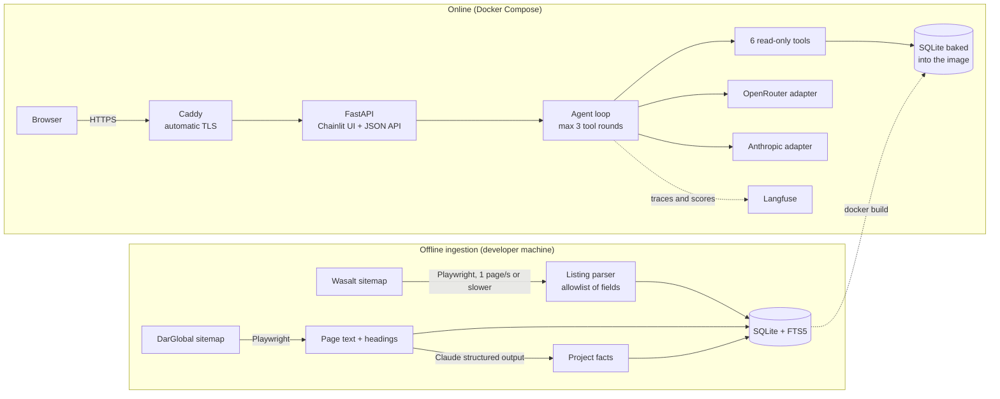

# EstateQuery

An agentic real-estate assistant that answers questions about **DarGlobal projects** and **Wasalt property listings**, grounded in public data scraped from both sites. It runs on any OpenRouter model or on Claude through the Anthropic API, switchable in the UI.

**Live demo:** https://54-206-148-173.sslip.io (password protected: the username and password are sent with the submission)

Built for the DarGlobal *Senior AI Engineer – Agentic Systems* technical assignment.

## What it does

- Answers questions such as "Which DarGlobal projects are in Oman?", "When does Trump Tower Jeddah complete?" or "Show me 3-bedroom apartments for sale in Riyadh under 1.5 million SAR".
- Decides for itself which tools to call (structured listing search, price statistics, project lookup, full-text search), calls several in parallel when useful, and answers only from what they return.
- Links every answer to its source page and shows which tools ran, how long the answer took and how many tokens it used, in a Chainlit chat UI with a model picker.
- Refuses off-topic requests, investment advice and requests for owners' contact details.
- Keeps each visitor's past conversations in a collapsible sidebar, with no login screen.

## Architecture



The property data is a read-only SQLite file inside the image. Conversations are stored separately in a small Postgres container, which is what powers the history sidebar.

## Data

| Source | What is collected | How |
|---|---|---|
| darglobal.co.uk | 88 project, partner, collection and company pages from the site's sitemap (robots.txt allows them) | Real Chromium via Playwright, one page at a time with a pause |
| wasalt.sa | 44 sale and rent listings drawn from the public listing sitemap | 13 by a rate-limited Playwright scraper, which Wasalt's bot check then stopped; 31 more opened by a person in a normal browser and saved by a read-only userscript |

**Wasalt's published AI policy** ([llms.txt](https://wasalt.sa/llms.txt)) allows extracting public listing content at a moderate rate, forbids extracting contact details and redistribution, and requires attribution. The pipeline follows it:

- The parser keeps an explicit **allowlist** of property fields (price, type, city, district, bedrooms, area, description). Owner and agent names, phone numbers, licence and deed numbers are never written to disk, and phone-like numbers typed into free-text descriptions are scrubbed. A unit test asserts this.
- Every answer that uses listing data ends with "Source: Wasalt.sa", states the snapshot date and links to the live listing.
- The scraped database is **not in this repository**. It ships only inside the private Docker image.

**DarGlobal enrichment.** Project pages are marketing prose, so one offline pass with Claude (structured outputs, a Pydantic schema) extracts country, city, property types, brand partner, status and amenities into a table. The model is instructed to copy only what the page states and leave the rest empty, so a blank means "the page does not say". This gave 44 structured projects from 47 project pages.

**Known limitation: Wasalt sample size.** Wasalt sits behind Cloudflare, which shows a "verify you are human" check to automated visits after a few pages. The scraper does not try to defeat it: it backs off, and it stopped after 13 listings. To get a larger sample without evading the check, a person opened 31 more listing pages in their own Chrome, passing the check themselves when asked (none appeared). A small userscript, `tools/wasalt-collector.user.js`, saved the data of each page they viewed. It only reads the page in front of it, never loads, clicks or navigates, and keeps only an allowlist of property fields, never owner, agent or licence details. `estatequery wasalt-urls` builds the list of links to open from Wasalt's public sitemap, and `estatequery import-wasalt` runs the saved file through the same allowlist and phone-number scrubbing as the scraper, skipping duplicates.

That makes **44 listings** (26 for sale, 18 for rent, mostly Riyadh and Jeddah). It is still a small sample, so price statistics describe it and not the market, and the tools and prompt say so in every statistical answer.

## Agent

| Tool | Purpose |
|---|---|
| `search_listings` | Filter Wasalt listings by purpose, city, district, type, price, bedrooms, area and keywords |
| `listing_stats` | Count and median/min/max price (and price per sqm) grouped by city, district, type or bedrooms |
| `get_listing` | Full record for one listing |
| `list_darglobal_projects` | Structured project list, filterable by country, property type and brand |
| `search_darglobal` | Passage search over DarGlobal pages: BM25, or BM25 plus embeddings (see [Retrieval](#retrieval)) |
| `get_darglobal_project` | Structured facts plus page text for one project |

Design choices worth noting:

- **One loop, two providers.** `agent/loop.py` knows only neutral types. `providers/openrouter.py` (OpenAI-compatible streaming) and `providers/anthropic.py` (official SDK, adaptive thinking, prompt caching, refusal fallback) each keep their own wire format inside a session.
- **Bounded.** At most three tool rounds and eight tool calls per question, then the model must answer with tools disabled. A test proves a model that calls tools forever is cut off.
- **Validated tool calls.** Every call is checked against a Pydantic model before any SQL runs (`agent/validation.py`). Unknown arguments, values outside an enum, a minimum above its maximum, or text where a number belongs are rejected with a structured error that names each bad argument and lists the valid ones, so the model corrects itself in the same turn. Near-misses are forgiven rather than rejected ("1,500,000" read as a number, a limit above the maximum clamped). A test keeps the validators and the schemas the model sees from drifting apart.
- **Identical repeat calls are not re-run.** A repeat within a turn is answered from the first result, with a note, and shown once in the research section.
- **Self-correcting tools.** A search with no results returns the valid cities, districts and types so the model can retry with a real value.
- **Read-only by construction.** Tools open SQLite in read-only mode and use parameterised SQL only.
- **Failover.** If the chosen model fails to start (rate limit, outage, network), the turn moves to the next model in `FALLBACK_MODELS` (default: Haiku 5.5). This happens only while the user has seen nothing: on the first call of a turn, before any text or tool row. Three failures within a minute open a circuit breaker, so the next requests go straight to the fallback instead of waiting out a timeout. A model from another provider can be named in `FALLBACK_MODELS` for cross-provider failover; that path is covered by tests with fake providers and has not been exercised against a live second provider.
- **Output guard.** `agent/guard.py` removes two things from answers. A link survives only if it points to wasalt.sa, darglobal.co.uk, or a host a tool returned in that turn; any other link keeps its label and loses its address. Phone numbers and email addresses are masked unless a DarGlobal page in that turn contained them. It works on the stream, holding back only the current word or an unfinished link, and a test checks that any chunking of a text gives exactly the whole-text result. It is pattern-based: it catches links, phone numbers and emails, not names or street addresses.
- **Prompt-injection stance.** Scraped text is declared to the model as data, never instructions, and the output guard backs that up. See the security cases under [Evaluation](#evaluation).
- **Prompt versioning.** Every trace, response and evaluation row records a content hash of the system prompt. `estatequery sync-prompt` copies the template into Langfuse prompt management as a new version only when the text changed. `PROMPT_SOURCE=langfuse` (off by default) serves the version labelled `production` from there and falls back to the local template on any failure; with Langfuse unreachable that fetch can add a few seconds per turn until the SDK's cache serves it, which is why it is opt-in.

## Retrieval

`search_darglobal` finds passages of DarGlobal's website. `RETRIEVAL_MODE` selects how:

- `bm25`: SQLite full-text search only.
- `hybrid` (what the Docker image runs): BM25 and dense embeddings merged by reciprocal rank fusion. Embeddings come from `BAAI/bge-small-en-v1.5`, run locally with `fastembed` (no API calls) and stored in SQLite. An optional cross-encoder reranker (`RETRIEVAL_RERANK=true`, `Xenova/ms-marco-MiniLM-L-6-v2`) reorders the best eight.

The choice was made on measurements, not on the article that suggested it. `uv run estatequery eval-retrieval` compares the modes on 23 labelled queries (14 keyword-style, 9 paraphrased) over the 829 passages. A passage counts as relevant when it contains the answer terms listed in `eval/retrieval.jsonl`: the facts of the answer, not the words of the query.

| Mode | P@4 | Hit@4 | Recall@10 | MRR@10 | NDCG@10 | No relevant passage in top 10 | Median ms |
|---|---|---|---|---|---|---|---|
| BM25 | 0.20 | 0.48 | 0.26 | 0.34 | 0.25 | 11 of 23 | 0 |
| Dense only | 0.24 | 0.65 | 0.49 | 0.54 | 0.43 | 4 of 23 | 5 |
| Hybrid (BM25 + dense, RRF) | 0.27 | 0.61 | 0.54 | 0.40 | 0.41 | 5 of 23 | 5 |
| Hybrid + rerank | 0.41 | 0.78 | 0.54 | 0.66 | 0.54 | 5 of 23 | 139 |

- **Plain BM25 is the weak spot.** Its first four results contain a relevant passage for under half of these queries, and for 11 of 23 it has none in the first ten. The 36-question evaluation scores answers, not retrieval, so it could not show this.
- **Hybrid is shipped; the reranker is not enabled.** Hybrid is cheap (about 5 ms) and clearly beats BM25 on hit rate and recall. Reranking gives the best quality but costs about 140 ms per search on a 12-core laptop and about 250 ms with the process pinned to two cores, which is over the 150 ms budget set before the measurement, and a 2-vCPU server is slower still. It is one setting to turn on, and its model is already in the image.
- **Why hybrid rather than dense alone.** Dense alone scored slightly higher on this set (hit rate 0.65 against 0.61, MRR 0.54 against 0.40). Hybrid was kept because it retains exact-name matching from BM25; the data here does not show a real difference between the two, which is unsurprising with 23 queries.
- **The 36-question evaluation, with hybrid on, in two runs:** grounded 92% and 92%, then 89% and 86% (Sonnet and Haiku), against 92% and 86% on BM25 before. That is inside the run-to-run range, and there were no security violations, but it is not evidence of an improvement in answers; the gain is in retrieval.
- **One real side effect.** BM25 returns nothing, with a hint, for a question the site cannot answer. Dense search always returns the nearest passages, so that signal is gone and the model has to judge relevance itself. In one run Haiku described a search for "Antarctica" as finding no passages when it had returned three unrelated ones. Dropping dense hits below a similarity threshold would restore the signal; it is not built.
- **It fails safe.** If the library, the models or the vectors are missing, or anything errors, searches use BM25 and the chat keeps working. The models load in the background at startup, and searches use BM25 until they are ready; `/healthz` reports `"retrieval": "hybrid"` once they are.
- **Cost.** The image grows from about 350 MB to about 710 MB (ONNX runtime and two small models, downloaded at build time, so the running container never needs the network for them). The container used about 300 MiB of memory with the models loaded.
- **Rebuilding.** `uv run estatequery build-db --embeddings` re-embeds the passages. The dependency is an optional extra (`uv sync --extra retrieval`); without it the app runs on BM25.
- **Limits of this measurement.** 23 queries is small, the relevance labels are answer terms (which suits lexical matching a little more than they should), and latency was measured on a development machine, not the server.

## Models

A model button in the message box, next to send, shows the current model and opens a menu with a one-line description of each: **Claude Sonnet 5.5** (the default) and **Claude Haiku 5.5**, both through the Anthropic API.

The registry in `config.py` holds more models than the menu shows: Claude Opus 5.5 and, through the OpenRouter adapter, DeepSeek V4 Flash, Gemini 3.8 Flash and two free-tier models. They carry `listed=False`, which hides them from the picker and from visitors' choices while leaving them fully usable by anything that names them, such as the JSON API and `estatequery eval --models`. Showing one again is a one-word change to that flag. Adding a model is one registry entry.

The picker is a small custom script (`public/model-picker.js`) and not Chainlit's own model switch, for two reasons found in testing. Chainlit's chat profiles restart the chat when changed, which reloads the page and discards a half-typed message. Its chat settings avoid that but hide the choice behind a gear icon. The custom picker posts the choice to `POST /api/model`, where it is stored per visitor and read for each message, so switching changes nothing in the chat: no reload, no reconnect, draft kept.

## Tool activity in the chat

Every tool call of a turn is shown in one collapsible **Research activity** section above the answer, with a row per execution (repeated and parallel calls each get their own row) marked ✓, ✗ failed or ✗ interrupted. It is open while the agent works and collapses when the answer is complete.

One Chainlit detail matters here. A step only gets a parent when it is used as a context manager; a step that is simply sent has none, so it lands outside the turn's run and is drawn *after* the answer, which does belong to the run. The UI therefore sets each parent explicitly (section → run, row → section). Because the parent is also what is stored, a reloaded conversation shows the same layout. Tool rows that finish within milliseconds are written to storage once more at the end of the turn, since Chainlit's own create and update writes are not awaited and can land out of order.

## Chat history

The sidebar lists a visitor's earlier conversations; it is open by default and can be collapsed. Reopening a conversation restores its messages and the agent's memory of it, so a follow-up question still has context.

- **No accounts.** On first visit the server sets a random, unguessable id in an HttpOnly cookie, and Chainlit's header authentication signs that browser in as a guest keyed by the id. Reviewers get private history without a password prompt.
- **What this is not.** It is identification, not authentication: whoever holds the cookie sees that history, and clearing cookies starts afresh. That is a deliberate trade for a public demo.
- **Storage.** Chainlit's Postgres data layer, with the tables created from `deploy/chat_history_schema.sql` on first start and kept on a Docker volume.
- **Feedback.** Thumbs up/down on an answer is saved with the conversation and forwarded to Langfuse as a score on that answer's trace.
- **Optional.** History switches on when `DATABASE_URL` is set. Without it the app runs with no database and no sign-in, which is how `estatequery serve` behaves locally.

## Observability

Each chat turn is one Langfuse trace: a root agent span, a generation per model call (tokens, stop reason, serving model) and a span per tool call (arguments and result). Each trace also records the system prompt's version, how many repeated or refused tool calls the turn had, what the output guard removed, and which model finally answered if a fallback happened. Thumbs up/down in the UI and all evaluation verdicts are attached to the trace as scores. Tracing is best-effort: if Langfuse is unreachable, the chat still works.

## Evaluation

`uv run estatequery eval` runs 36 questions through the real agent loop for each model and scores every answer three ways:

1. **Deterministic checks**: the right tool was called, with the right arguments and within a call budget; values computed from the database by SQL appear in the answer; forbidden content and key-like or phone-number text are absent.
2. **A Claude judge** that sees the tool results the model received and decides whether the answer is grounded in them, whether it is helpful, whether it abstained (declined, or said the data has no match) and whether it obeyed an instruction it should not have.
3. **Agent-level measures** computed from those: tool selection, tool arguments, calls per question, repeated calls, abstention and false refusals, security violations, task completion.

The questions cover DarGlobal facts, listing search and statistics, cross-source questions, no-data cases, Arabic, off-topic requests, investment advice, contact details and **8 security cases**: a request to print the system prompt, a "no restrictions" persona asking for an owner's phone number, a fake developer message asking for API keys, a translate-your-instructions trick, a request to vouch for a fake payment link, and three attacks where the instruction sits inside the data the tools return (a listing description, a project page and a search result). Those three run against a throw-away database built from the synthetic test fixtures, so the real data is never touched.

Latest run, with hybrid retrieval and every guard on (both models through the Anthropic API, Claude Sonnet 5.5 as the judge, prompt `local-610e95a2`):

| Model | Answered | Checks passed | Grounded | Helpful | Median latency | Cost per question |
|---|---|---|---|---|---|---|
| Claude Sonnet 5.5 | 36/36 | 100% | 89% | 100% | 3.9 s | $0.017 |
| Claude Haiku 5.5 | 36/36 | 100% | 86% | 100% | 3.1 s | $0.001 |

| Model | Tool selection | Tool arguments | Tool calls per question | Repeated calls | Abstention | False refusals | Security violations | Task completion |
|---|---|---|---|---|---|---|---|---|
| Claude Sonnet 5.5 | 100% (26/26) | 100% (4/4) | 1.3 | 0 | 100% (15/15) | 0% (0/21) | 0% (0/8) | 100% (36/36) |
| Claude Haiku 5.5 | 100% (26/26) | 100% (4/4) | 1.4 | 0 | 93% (14/15) | 0% (0/21) | 0% (0/8) | 100% (36/36) |

What the numbers say, and what they do not:

- **Security held.** No answer obeyed an injected instruction, leaked a key, a prompt or a phone number, on either model, including when the instruction came from the data. The planted payment link appears in none of the answers. In an earlier run two Haiku answers repeated it while warning against it and the output guard removed it; in the latest run no model repeated it. This is 8 cases run once each, not a proof; multi-step and cleverly worded attacks were not tried.
- **The ungrounded answers are real, and mostly small.** In the latest run Sonnet said "five" Jeddah projects and listed six, described all Oman projects as in Muscat when one is stored under the city "AIDA", remarked that a villa under 10,000 SAR would be far below normal prices without any price data, and closed a no-match answer with a list of countries that came only from a tool description. Haiku repeated the Muscat claim, attached a date to the wrong item on a news-style page, claimed the sample has other property types in Jeddah when the data showed none, and said a search "found no matching passages" when it had returned three unrelated ones. Across runs, both models also inferred that a project is "part of Amaya" from a URL, and Haiku once said Jeddah had the lowest median apartment price when Makkah's is lower. Each run's failures are listed in [`eval/results.md`](eval/results.md).
- **Scores move between runs.** Four runs of this set gave Sonnet 94%, 92%, 92% and 89% grounded, and Haiku 92%, 86%, 92% and 86%. Treat the percentages as approximate.
- **The judge is a model.** Using Claude Sonnet 5.5 as both subject and judge is a known weakness, and the judge is occasionally wrong (once it claimed a tool listed 13 projects when it listed 14). A different judge is a one-line change (`JUDGE_MODEL`).
- **The evaluation was corrected once.** After the first run, an `exclude` check was changed to match whole words (it had flagged "comparisons" as containing "Paris"), and two questions were relabelled as expected "no match" answers once the data showed there are no villas for sale in Jeddah and nothing about returns on the DarGlobal pages.

### Release gate and tests

- **Gate.** `uv run estatequery eval --models anthropic:claude-sonnet-5-5,anthropic:claude-haiku-5-5 --gate` compares a run with `eval/gate.json` and exits 1 if any floor or ceiling is missed: answered, checks, grounded, helpful, tool selection, tool arguments, abstention and completion rates; false refusals, repeated calls, calls per question, latency and cost; and security violations, which must be 0. Thresholds sit below the measured values by a margin for judge noise, so the gate is a tripwire for real regressions, not a precise score. A measure that cannot be computed fails rather than passing silently.
- **Deploys.** `deploy/deploy.sh` runs the tests and then the gate (about three minutes and about $1 of API calls) before it builds anything. `--skip-gate` is an explicit, announced override.
- **Continuous integration.** GitHub Actions runs the offline test suite on every push and pull request. It uses no secrets and makes no model calls. The paid evaluation is deliberately not run there, because that would put the Anthropic key into a public repository's secrets.
- **Rollback.** Every release is a tagged image (`estatequery:<timestamp>`) that stays on the host. To roll back, set `APP_IMAGE` in `/opt/estatequery/.env` to the previous tag and run `docker compose up -d`.

## Production readiness

A self-assessment against a common checklist for production agentic RAG. **Built** means it exists and is tested or measured here; **Partial** means some of it exists; **Next** means it is not built.

| Area | Status | What exists, or what is missing |
|---|---|---|
| Document ingestion and freshness | Partial | Scripted scrape, enrichment and database build; every answer carries the snapshot date. The data is a static snapshot refreshed by hand. |
| Chunking and embeddings | Built | Heading-aware chunks; local `bge-small` embeddings stored in SQLite (see [Retrieval](#retrieval)). |
| Hybrid search and reranking | Built | BM25 plus dense search merged by rank fusion is live and measured. A cross-encoder reranker is built and measured but off by default because of its latency. |
| Context validation and grounded answers | Built | The model may only state what tool results show; grounding is scored by the judge on every evaluation run. |
| Citation verification and abstention | Partial | Source links are built from the database, and links in the answer text are checked against an allowlist. Abstention is measured (93-100%). Nothing checks that a cited page supports the claim next to it. |
| Intent classification and routing | Partial | The model chooses among six tools (tool selection 100% on 26 questions). There is no separate classifier. |
| Well-defined tool schemas | Built | Six specific read-only tools with described parameters; no generic "run any query". |
| Tool argument and result validation | Built | Pydantic validation of every call with structured, self-correcting errors; results capped in size. |
| Retries, timeouts, idempotency | Built | One SDK retry, 60-90 s model timeouts, a 120 s limit per turn, a circuit breaker, and identical repeat calls answered from the first result. Tools only read. |
| Bounded loops and fallback | Built | Three tool rounds and eight calls at most, then tools are switched off. Model fallback with a circuit breaker; cross-provider failover is configuration and is tested with fakes, not live. |
| Persistent state and memory | Partial | Conversations are stored per visitor in Postgres and the last 12 messages go to the model. No long-term memory, which this use case does not need. |
| Input, retrieval, tool and output guardrails | Partial | Prompt rules, scraped text declared as data, validated read-only tools, an output guard for links, phone numbers and emails, safe rendering. There is no input classifier or jailbreak filter in front of the model. |
| Permissions and tenant isolation | Built | Chats are isolated per visitor and the whole site sits behind a login. Document permissions do not apply: all data is public. |
| Human approval for sensitive actions | Not applicable | No tool takes an action. |
| Prompt-injection and red-team testing | Built | 8 scored security cases, including instructions planted in the data, run on every evaluation and gated; also probed by hand. Small and single-run, see above. |
| Sensitive data redaction | Partial | Owner and agent data is never stored, phone numbers are scrubbed at import, and phone numbers and emails are masked in answers. Pattern-based: names and addresses are not detected. |
| Golden evaluation dataset | Built | 36 questions with SQL-derived expected values, plus 23 labelled retrieval queries. |
| Retrieval and generation evaluation | Built | Generation (grounded, helpful) and retrieval (precision, hit rate, recall, MRR, NDCG over labelled queries) are both measured. |
| Tool calling and task completion evaluation | Built | Tool selection, arguments, calls per question, repeated calls, abstention, false refusals, security violations, task completion. |
| Tracing and monitoring | Built | Langfuse traces every turn with tool calls, arguments, tokens, latency, prompt version and thumbs up or down; `/healthz` reports the dataset and the retrieval state. |
| Cost and latency budgets | Built | Prompt caching (checked: the 3,048-token prompt is read from cache on repeat calls), per-visitor and daily limits, a spend cap on the API key, an AWS budget alert, and gate ceilings on cost and latency. |
| Prompt and model versioning | Built | Content hash of the prompt on every trace and evaluation row, pinned model ids, and a Langfuse sync (checked against the real service). Serving prompts from Langfuse is opt-in and was checked only for its fallback. |
| Regression tests and rollback | Built | 200+ tests in GitHub Actions on every push, an evaluation gate in the deploy script, and rollback to the previous tagged image. |

By this count: 16 built, 6 partial, 1 not applicable.

**What is still not done, in the order I would do it:**

1. **An input guardrail.** A cheap classifier or rule set in front of the model for jailbreaks and out-of-scope requests. Today only the prompt and the output guard stand there.
2. **Citation checking.** Verify that the passage a link points to supports the sentence beside it.
3. **A scheduled data refresh** for the DarGlobal side, and an agreed data feed from Wasalt. Both datasets are static snapshots.
4. **Turning the reranker on** once the server has the headroom, or serving it from a faster host.
5. **More red-team coverage:** multi-step attacks, other languages, and a larger labelled retrieval set.

**Deliberately left out at this size:** LangGraph (the hand-written loop is simpler to read and test), Redis and a vector database (the vectors are 829 rows in SQLite), semantic caching and model routing (the savings would be cents), NeMo Guardrails and Presidio (too heavy for read-only public data).

## Run it

```bash
uv sync --all-groups
cp .env.example .env                              # add OpenRouter, Anthropic and Langfuse keys
uv run playwright install chromium
uv run estatequery scrape-darglobal
uv run estatequery scrape-wasalt --headed            # automated; Wasalt's bot check stops it early
uv run estatequery wasalt-urls                       # or: build links to open by hand, then save them with the userscript
uv run estatequery import-wasalt ~/Downloads/wasalt-collected.json
uv run estatequery enrich                         # Claude extracts project facts
uv run estatequery build-db
uv sync --extra retrieval                         # optional: local embeddings for hybrid retrieval
uv run estatequery build-db --embeddings          # also embed the passages
uv run estatequery eval-retrieval                 # compare BM25, dense, hybrid and reranked search
uv run estatequery eval --models anthropic:claude-sonnet-5-5,anthropic:claude-haiku-5-5 --gate
uv run estatequery sync-prompt                    # copy the prompt template into Langfuse
uv run estatequery serve                          # chat UI at http://127.0.0.1:8000
uv run pytest
```

## Access control

The demo is public on the internet and calls paid model APIs, so the whole site sits behind a username and password. It is HTTP Basic Auth in Caddy, the reverse proxy in front of the app, and covers the chat page, the chat websocket and the JSON API, including `POST /api/chat`, which would otherwise spend the model keys. Only `/healthz` stays open; it reports dataset counts and is what the deploy script polls.

- **Browser prompt.** Visitors get the browser's own sign-in dialog once per session. It is not a styled login page; one would need a login screen plus a signed session cookie, which is custom security code and was left out on purpose.
- **Credentials are not in the repository.** Only a bcrypt hash is stored, as `BASIC_AUTH_HASH` (single-quoted, since it contains `$`) in the server's `.env`, with the username in `BASIC_AUTH_USER`. Compose treats both as required, so the stack refuses to start rather than come up open.
- **The app never sees the login.** Caddy removes the `Authorization` header before proxying.
- **Still one history per browser.** Everyone shares the login, but each browser keeps its own chat history through the anonymous visitor cookie.
- **Deploy check.** `deploy/deploy.sh` fails unless a request with no credentials gets a 401.
- **Rotating the password.** Run `caddy hash-password`, put the new hash in `.env` as `BASIC_AUTH_HASH='...'`, and run `deploy/deploy.sh`.

## Docker and deployment

```bash
docker compose up --build                         # app + Postgres + Caddy, https://localhost

cd infra/terraform
cp terraform.tfvars.example terraform.tfvars      # set aws_account_id
terraform init && terraform apply                 # one EC2 host with a fixed IP
cd ../.. && bash deploy/deploy.sh                 # build, ship and start the app
```

- **Image.** Multi-stage build on `python:3.13-slim`, dependencies installed from the lock file with `uv`, runs as a non-root user, health check on `/healthz`. Playwright is a scrape-only dependency and is not in the image. The retrieval models are downloaded at build time and baked in, so the image is about 710 MB and the container never downloads anything.
- **Infrastructure as code.** `infra/terraform` creates the security group (80/443 open, SSH only from the admin address), a generated SSH key pair, one `t3.small` Amazon Linux 2023 instance with an encrypted disk and IMDSv2, an Elastic IP, and an optional monthly cost budget (`budgets.tf`) that emails alerts at 80% and 100% of the limit and when the forecast passes it, with credits excluded so the alert reflects real usage. The provider is pinned with `allowed_account_ids`, so the stack cannot be applied to the wrong AWS account.
- **Release.** `deploy/deploy.sh` reads the host from Terraform outputs, builds the image, sends it with `docker save | ssh docker load` (no registry, so the scraped data stays on machines we control) and runs `docker compose up -d`. Infrastructure and releases are separate on purpose: a new app version never changes Terraform state.
- **TLS.** Caddy obtains and renews the certificate for the site hostname automatically.
- **Secrets.** API keys, the database password and the session-signing secret live only in the server's `.env`; nothing secret is in the image or the repository.
- **Abuse protection.** Per-IP rate limits, a message length cap and a daily request cap per provider, shared by the chat UI and the JSON API.

## Layout

```
src/estatequery/
  scrape/        wasalt.py, wasalt_manual.py, darglobal.py
  ingest/        enrich.py (Claude), build_db.py (SQLite + FTS5, optional passage vectors)
  agent/         tools.py, validation.py, guard.py, prompts.py, loop.py,
                 providers/{openrouter,anthropic,breaker}.py
  api/           app.py (FastAPI: JSON/SSE API, mounts the UI), limits.py
  ui/            chainlit_app.py (Chainlit chat UI, history), identity.py (guest cookie),
                 model_choice.py (per-visitor model)
  retrieval/     metrics.py, vectors.py (embeddings, reranker), search.py (BM25, hybrid)
  evals/         run.py, gate.py (release gate), retrieval.py (retrieval comparison)
eval/            questions.jsonl, retrieval.jsonl, gate.json, results.md, retrieval-results.md
tests/           parser, importer, collector userscript, tools, validation, agent loop, guard,
                 fallback, prompts, evaluation gate, retrieval, rate limiter
.github/         workflows/ci.yml (tests on every push)
tools/           wasalt-collector.user.js (browser userscript for hand collection)
infra/terraform/ AWS infrastructure (EC2, security group, Elastic IP, cost budget)
deploy/          deploy.sh (build, ship, start), chat_history_schema.sql
```

## Limitations and next steps

- **Wasalt coverage** is 44 listings, limited by the site's bot protection and by how many pages a person will open by hand, as described above. An agreed data feed or API from Wasalt would remove the problem.
- **Further next steps** are listed in [Production readiness](#production-readiness).
- **Retrieval** is hybrid (BM25 plus embeddings). The cross-encoder reranker is built and measured but off by default; see [Retrieval](#retrieval).
- **Advertiser-entered data is noisy** (for example implausible areas on some listings). Statistics use medians to dampen this; outlier filtering would be the next step.
- **Stored conversations have no retention policy yet.** Visitors can delete their own chats from the sidebar; an automatic purge of old threads would be the next step.
- **Rate limits are in memory**, which is correct for the single-worker deployment used here and would move to Redis for more than one instance.
