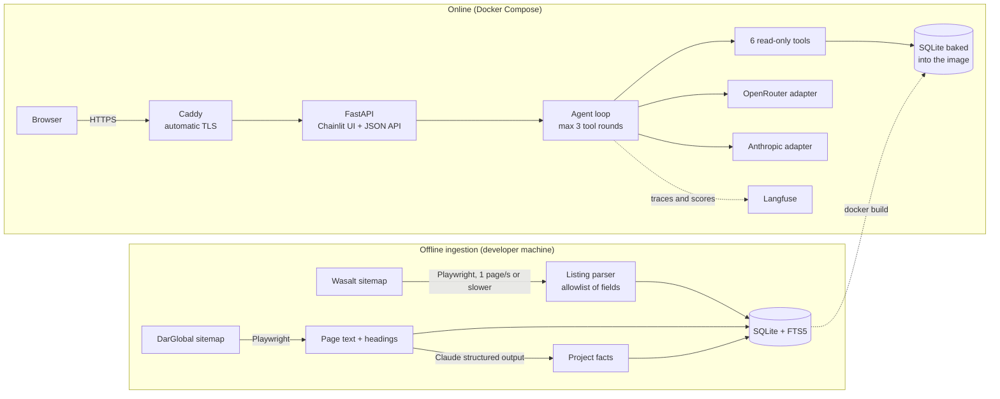

# EstateQuery

An agentic real-estate assistant that answers questions about **DarGlobal projects** and **Wasalt property listings**, grounded in public data scraped from both sites. It runs on any OpenRouter model or on Claude through the Anthropic API, switchable in the UI.

**Live demo:** https://54-206-148-173.sslip.io (password protected: the username and password are sent with the submission)

Built for the DarGlobal *Senior AI Engineer – Agentic Systems* technical assignment.

## What it does

- Answers questions such as "Which DarGlobal projects are in Oman?", "When does Trump Tower Jeddah complete?" or "Show me 3-bedroom apartments for sale in Riyadh under 1.5 million SAR".
- Decides for itself which tools to call (structured listing search, price statistics, project lookup, full-text search), calls several in parallel when useful, and answers only from what they return.
- Links every answer to its source page and shows which tools ran, how long the answer took and how many tokens it used, in a Chainlit chat UI with a model picker.
- Refuses off-topic requests, investment advice and requests for owners' contact details.
- Keeps each visitor's past conversations in a collapsible sidebar, with no login screen.

## Architecture



The property data is a read-only SQLite file inside the image. Conversations are stored separately in a small Postgres container, which is what powers the history sidebar.

## Data

| Source | What is collected | How |
|---|---|---|
| darglobal.co.uk | 88 project, partner, collection and company pages from the site's sitemap (robots.txt allows them) | Real Chromium via Playwright, one page at a time with a pause |
| wasalt.sa | A sample of sale and rent listings from the public listing sitemap | Real Chromium via Playwright, sequential and rate-limited |

**Wasalt's published AI policy** ([llms.txt](https://wasalt.sa/llms.txt)) allows extracting public listing content at a moderate rate, forbids extracting contact details and redistribution, and requires attribution. The pipeline follows it:

- The parser keeps an explicit **allowlist** of property fields (price, type, city, district, bedrooms, area, description). Owner and agent names, phone numbers, licence and deed numbers are never written to disk, and phone-like numbers typed into free-text descriptions are scrubbed. A unit test asserts this.
- Every answer that uses listing data ends with "Source: Wasalt.sa", states the snapshot date and links to the live listing.
- The scraped database is **not in this repository**. It ships only inside the private Docker image.

**DarGlobal enrichment.** Project pages are marketing prose, so one offline pass with Claude (structured outputs, a Pydantic schema) extracts country, city, property types, brand partner, status and amenities into a table. The model is instructed to copy only what the page states and leave the rest empty, so a blank means "the page does not say". This gave 44 structured projects from 47 project pages.

**Known limitation: Wasalt sample size.** Wasalt sits behind Cloudflare, which presents a browser check to automated visits after a few pages. The scraper does not try to defeat it: it backs off and stops if the check does not clear. The Wasalt sample is therefore small (the exact count is shown in the UI header and at `/healthz`), and price statistics describe that sample, not the market. The tools and prompt say so in every statistical answer.

## Agent

| Tool | Purpose |
|---|---|
| `search_listings` | Filter Wasalt listings by purpose, city, district, type, price, bedrooms, area and keywords |
| `listing_stats` | Count and median/min/max price (and price per sqm) grouped by city, district, type or bedrooms |
| `get_listing` | Full record for one listing |
| `list_darglobal_projects` | Structured project list, filterable by country, property type and brand |
| `search_darglobal` | BM25 full-text search over DarGlobal page passages |
| `get_darglobal_project` | Structured facts plus page text for one project |

Design choices worth noting:

- **One loop, two providers.** `agent/loop.py` knows only neutral types. `providers/openrouter.py` (OpenAI-compatible streaming) and `providers/anthropic.py` (official SDK, adaptive thinking, prompt caching, refusal fallback) each keep the conversation in their own wire format, so provider-specific blocks round-trip unchanged.
- **Bounded.** At most three tool rounds, then the model must answer with tools disabled. A test proves a model that calls tools forever is cut off.
- **Self-correcting tools.** A search with no results returns the valid cities, districts and types so the model can retry with a real value. Malformed tool arguments come back as an error result, not an exception.
- **Read-only by construction.** Tools open SQLite in read-only mode and use parameterised SQL only.
- **Prompt-injection stance.** Scraped text is declared to the model as data, never instructions.

## Models

A model button in the message box, next to send, shows the current model and opens a menu with a one-line description of each: **Claude Sonnet 5.5** (the default) and **Claude Haiku 5.5**, both through the Anthropic API.

The registry in `config.py` holds more models than the menu shows: Claude Opus 5.5 and, through the OpenRouter adapter, DeepSeek V4 Flash, Gemini 3.8 Flash and two free-tier models. They carry `listed=False`, which hides them from the picker and from visitors' choices while leaving them fully usable by anything that names them, such as the JSON API and `estatequery eval --models`. Showing one again is a one-word change to that flag. Adding a model is one registry entry.

The picker is a small custom script (`public/model-picker.js`) and not Chainlit's own model switch, for two reasons found in testing. Chainlit's chat profiles restart the chat when changed, which reloads the page and discards a half-typed message. Its chat settings avoid that but hide the choice behind a gear icon. The custom picker posts the choice to `POST /api/model`, where it is stored per visitor and read for each message, so switching changes nothing in the chat: no reload, no reconnect, draft kept.

## Tool activity in the chat

Every tool call of a turn is shown in one collapsible **Research activity** section above the answer, with a row per execution (repeated and parallel calls each get their own row) marked ✓, ✗ failed or ✗ interrupted. It is open while the agent works and collapses when the answer is complete.

One Chainlit detail matters here. A step only gets a parent when it is used as a context manager; a step that is simply sent has none, so it lands outside the turn's run and is drawn *after* the answer, which does belong to the run. The UI therefore sets each parent explicitly (section → run, row → section). Because the parent is also what is stored, a reloaded conversation shows the same layout. Tool rows that finish within milliseconds are written to storage once more at the end of the turn, since Chainlit's own create and update writes are not awaited and can land out of order.

## Chat history

The sidebar lists a visitor's earlier conversations; it is open by default and can be collapsed. Reopening a conversation restores its messages and the agent's memory of it, so a follow-up question still has context.

- **No accounts.** On first visit the server sets a random, unguessable id in an HttpOnly cookie, and Chainlit's header authentication signs that browser in as a guest keyed by the id. Reviewers get private history without a password prompt.
- **What this is not.** It is identification, not authentication: whoever holds the cookie sees that history, and clearing cookies starts afresh. That is a deliberate trade for a public demo.
- **Storage.** Chainlit's Postgres data layer, with the tables created from `deploy/chat_history_schema.sql` on first start and kept on a Docker volume.
- **Feedback.** Thumbs up/down on an answer is saved with the conversation and forwarded to Langfuse as a score on that answer's trace.
- **Optional.** History switches on when `DATABASE_URL` is set. Without it the app runs with no database and no sign-in, which is how `estatequery serve` behaves locally.

## Observability

Each chat turn is one Langfuse trace: a root agent span, a generation per model call (tokens, stop reason, serving model) and a span per tool call (arguments and result). Thumbs up/down in the UI and all evaluation verdicts are attached to the trace as scores. Tracing is best-effort: if Langfuse is unreachable, the chat still works.

## Evaluation

`uv run estatequery eval` runs 25 questions through the real agent loop for each model and scores every answer two ways:

1. **Deterministic checks**: the right tool was called, values computed from the database by SQL appear in the answer, forbidden content is absent.
2. **A Claude judge** that sees the tool results the model received and decides whether the answer is grounded in them and helpful.

The questions cover DarGlobal facts, listing search and statistics, cross-source questions, no-data cases, Arabic, off-topic requests, investment advice, contact details and prompt injection.

Latest run (Claude Sonnet 5.5 through the Anthropic API as both the model under test and the judge):

| Model | Answered | Checks passed | Grounded | Helpful | Median latency | Cost per question |
|---|---|---|---|---|---|---|
| Claude Sonnet 5.5 | 25/25 | 100% | 96% | 100% | 4.6 s | $0.017 |

The one answer judged ungrounded added a generalisation the data only half supports ("most are in Muscat" when two projects list only "AIDA" as their city). Runs vary by an answer or two, so treat the percentages as approximate. They are listed in [`eval/results.md`](eval/results.md). Using the same model as subject and judge is a known weakness; a different judge model is a one-line change (`JUDGE_MODEL`).

## Run it

```bash
uv sync --all-groups
cp .env.example .env                              # add OpenRouter, Anthropic and Langfuse keys
uv run playwright install chromium
uv run estatequery scrape-darglobal
uv run estatequery scrape-wasalt --headed
uv run estatequery enrich                         # Claude extracts project facts
uv run estatequery build-db
uv run estatequery serve                          # chat UI at http://127.0.0.1:8000
uv run pytest
```

## Access control

The demo is public on the internet and calls paid model APIs, so the whole site sits behind a username and password. It is HTTP Basic Auth in Caddy, the reverse proxy in front of the app, and covers the chat page, the chat websocket and the JSON API, including `POST /api/chat`, which would otherwise spend the model keys. Only `/healthz` stays open; it reports dataset counts and is what the deploy script polls.

- **Browser prompt.** Visitors get the browser's own sign-in dialog once per session. It is not a styled login page; one would need a login screen plus a signed session cookie, which is custom security code and was left out on purpose.
- **Credentials are not in the repository.** Only a bcrypt hash is stored, as `BASIC_AUTH_HASH` (single-quoted, since it contains `$`) in the server's `.env`, with the username in `BASIC_AUTH_USER`. Compose treats both as required, so the stack refuses to start rather than come up open.
- **The app never sees the login.** Caddy removes the `Authorization` header before proxying.
- **Still one history per browser.** Everyone shares the login, but each browser keeps its own chat history through the anonymous visitor cookie.
- **Deploy check.** `deploy/deploy.sh` fails unless a request with no credentials gets a 401.
- **Rotating the password.** Run `caddy hash-password`, put the new hash in `.env` as `BASIC_AUTH_HASH='...'`, and run `deploy/deploy.sh`.

## Docker and deployment

```bash
docker compose up --build                         # app + Postgres + Caddy, https://localhost

cd infra/terraform
cp terraform.tfvars.example terraform.tfvars      # set aws_account_id
terraform init && terraform apply                 # one EC2 host with a fixed IP
cd ../.. && bash deploy/deploy.sh                 # build, ship and start the app
```

- **Image.** Multi-stage build on `python:3.13-slim`, dependencies installed from the lock file with `uv`, runs as a non-root user, health check on `/healthz`. Playwright is a scrape-only dependency and is not in the image.
- **Infrastructure as code.** `infra/terraform` creates the security group (80/443 open, SSH only from the admin address), a generated SSH key pair, one `t3.small` Amazon Linux 2023 instance with an encrypted disk and IMDSv2, an Elastic IP, and an optional monthly cost budget (`budgets.tf`) that emails alerts at 80% and 100% of the limit and when the forecast passes it, with credits excluded so the alert reflects real usage. The provider is pinned with `allowed_account_ids`, so the stack cannot be applied to the wrong AWS account.
- **Release.** `deploy/deploy.sh` reads the host from Terraform outputs, builds the image, sends it with `docker save | ssh docker load` (no registry, so the scraped data stays on machines we control) and runs `docker compose up -d`. Infrastructure and releases are separate on purpose: a new app version never changes Terraform state.
- **TLS.** Caddy obtains and renews the certificate for the site hostname automatically.
- **Secrets.** API keys, the database password and the session-signing secret live only in the server's `.env`; nothing secret is in the image or the repository.
- **Abuse protection.** Per-IP rate limits, a message length cap and a daily request cap per provider, shared by the chat UI and the JSON API.

## Layout

```
src/estatequery/
  scrape/        wasalt.py, darglobal.py
  ingest/        enrich.py (Claude), build_db.py (SQLite + FTS5)
  agent/         tools.py, prompts.py, loop.py, providers/{openrouter,anthropic}.py
  api/           app.py (FastAPI: JSON/SSE API, mounts the UI), limits.py
  ui/            chainlit_app.py (Chainlit chat UI, history), identity.py (guest cookie),
                 model_choice.py (per-visitor model)
  evals/         run.py
eval/            questions.jsonl, results.md
tests/           parser, tools, agent loop, rate limiter
infra/terraform/ AWS infrastructure (EC2, security group, Elastic IP)
deploy/          deploy.sh (build, ship, start), chat_history_schema.sql
```

## Limitations and next steps

- **Wasalt coverage** is limited by the site's bot protection, as described above. An agreed data feed or API from Wasalt would remove the problem.
- **Retrieval is lexical** (BM25). It works well at this corpus size because the model writes the search query, but embeddings would help vague questions.
- **Advertiser-entered data is noisy** (for example implausible areas on some listings). Statistics use medians to dampen this; outlier filtering would be the next step.
- **Stored conversations have no retention policy yet.** Visitors can delete their own chats from the sidebar; an automatic purge of old threads would be the next step.
- **Rate limits are in memory**, which is correct for the single-worker deployment used here and would move to Redis for more than one instance.
